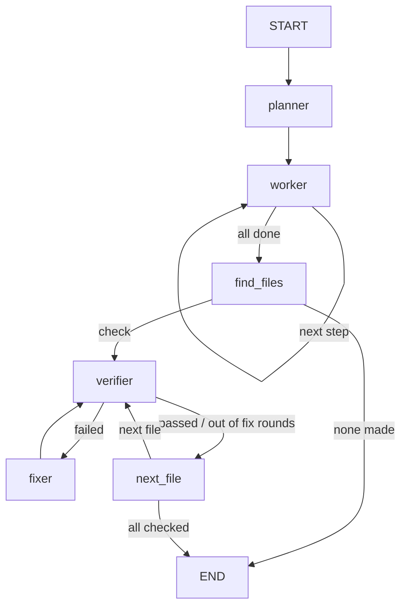

# Multimodal Ingestion Pipeline

Takes text, PDF, Word and video files, extracts their content, splits it into chunks with
metadata, embeds each chunk, and stores everything in a Qdrant vector database for search
and RAG.

| Input | Formats | How it is read |
|---|---|---|
| Text | `.txt` `.md` `.csv` | Any common encoding converted to UTF-8; Markdown split at headings; CSV rows kept with their column names |
| PDF | `.pdf` (digital or scanned) | Docling: layout, reading order, tables, OCR for scanned pages |
| Word | `.docx` | Docling: headings, lists, tables (headers/footers left out); text inside pictures read with OCR |
| Video | `.mp4` `.mov` `.mkv` `.webm` | ffmpeg + Whisper timestamped transcript; scene detection (PySceneDetect) with on-screen text read by OCR per scene; speech labelled with its slide's title; optional scene descriptions with a vision model |

On top of the search sits a chat with your documents (answers with citations, a question
router, chat memory) and agents that make and check files, using Google's Gemini or our own
copy of Gemma 4 on a Modal GPU; users each see only their own and shared files.

Where data goes: ingestion and search run on this machine (models downloaded once from
Hugging Face) or, for PDFs and video, on your own Modal GPUs. The chat, router, memory and
agents send the question and the passages found to the language model: with Gemini, to
Google (on the free tier Google may use that to improve its products: use a paid key for
confidential documents); with `llm_backend: modal`, only to your own Modal account.

## Setup (Windows, macOS, Linux)

Needs Python 3.11+ and [ffmpeg](https://ffmpeg.org/) on your PATH.

```powershell
py -3.13 -m venv .venv          # macOS/Linux: python3 -m venv .venv
.venv\Scripts\activate          # macOS/Linux: source .venv/bin/activate
pip install -e ".[dev]"
```

The first run downloads models (about 1 GB in total, more with frame captions).

## Using it

### Interactive (type your choices in the terminal)

```powershell
ingest
```

```
Multimodal Ingestion Pipeline  (0 chunks stored)

What would you like to do?
  1  Ingest a file or folder
  2  Search the stored content
  3  Delete a file's data
  4  Show stats
  5  View stored chunks and their embeddings
  6  Export all chunks + embeddings to a JSON file
  q  Quit
> 1
File or folder path (you can drag it here): C:\Users\me\Documents\policies
```

You can drag a file or folder from Explorer into the terminal instead of typing the path.

### Web page (upload files, browse chunks)

```powershell
ingest web                 # opens http://127.0.0.1:8000 in your browser
ingest web --port 8080     # another port
```

- **Upload:** drop files or choose them, tick any slow extras (picture descriptions, video
  frame captions), press *Upload and ingest*. Each file shows queued → processing →
  processed / skipped / failed, with the reason. Files are processed one at a time in the
  background and kept in `data/uploads`.
- **Documents:** everything in the database, newest first, with chunk counts.
- **Chunks:** click a document to see every chunk in reading order with its page or time
  range, heading, type and an embedding preview. "Find in chunks" highlights matches.
  "Delete document" removes its chunks (and the uploaded copy).

The page is only reachable from this computer. It uses whatever database the pipeline is
set to (`.env` / `config.yaml`). With the local `qdrant_data` folder, close any other
`ingest` window first, since only one program can open it at a time.

### One command at a time

```powershell
ingest run data\input                     # a folder (searched recursively)
ingest run report.pdf notes.docx talk.mp4  # specific files
ingest run talk.mp4 --frame-captions      # also describe slides/diagrams in the video
ingest run data\input --force             # re-process files even if unchanged
ingest run data\input --re-extract        # read files again instead of using saved extractions
ingest sync data\input                    # also remove deleted files, re-apply access.yaml
ingest reindex                            # rebuild the collection from saved extractions
ingest search "what is the leave policy?"   # best passages, with citations
ingest search "KF-26-5001" --chunks          # the matched chunks alone
ingest search "revenue" --file-type video
ingest search "salary bands" --groups hr  # only what the hr group may read
ingest delete report.pdf                  # remove one file's chunks
ingest stats                              # how many chunks, and where the database is
ingest show                               # print stored chunks with their embeddings
ingest show --file leave_policy --full    # one file's chunks, every embedding number
ingest export                             # everything, incl. full embeddings, to exports\*.json
```

The database file (`qdrant_data\collection\ingestion-bge-m3\storage.sqlite`) can't be read directly:
local Qdrant saves each chunk as a pickled Python object. Use `show` or `export` to see it.

Every `run` prints a summary and saves it to `reports\run-<time>.json`. Detailed per-stage
logs (JSON lines, with timings and errors) go to `logs\ingest.jsonl`.

## Cloud GPU (Modal)

The slow steps can run on a [Modal](https://modal.com) GPU: PDFs (layout, tables, OCR),
picture descriptions, video transcription and frame captions. Text and Word files, chunking,
embedding and storage stay on this machine. On the GPU, larger and more accurate models are
used (`gpu_whisper_model`, `gpu_vision_model` in `config.yaml`).

```powershell
pip install -e ".[gpu]"     # installs the modal package
modal setup                 # once: log in to your Modal account
ingest gpu-check            # first time: builds the GPU image (several minutes)
ingest run data\input --gpu   # one run on the GPU
ingest run data\input --local # one run on this machine (e.g. offline)
```

It is **on by default** (`gpu_backend: modal` in `config.yaml`): the GPU runs the bigger
models, such as Whisper large-v3-turbo for video speech instead of `base`, and the formula
model for equations. On the web page, untick *Use cloud GPU* to
keep an upload on this machine. Only what is needed is uploaded: the PDF or Word file, a compressed
audio track (about 11 MB per hour of video) and one keyframe per video scene.

- The first file of each run waits for a GPU container to start (roughly 20–60 s); later
  files reuse it. It shuts down 2 minutes after the last file, or when the program exits.
- The connection to Modal is closed 5 minutes after the last GPU step and reopened by the
  next one (a few seconds). If the laptop sleeps or loses its connection, Modal stops the app;
  this is noticed and logged in one line, and the next GPU step, or one that was cut off,
  runs on a new app instead of waiting forever.
- Models are downloaded once into the Modal volume `ingest-models`.
- Modal bills per second of GPU time; `modal_gpu` picks the GPU type (`T4` is cheapest).
- Files leave this machine for Modal's servers, so check this is allowed for your documents.

## How it behaves

- **Unchanged files are skipped.** Each file is identified by a SHA-256 hash of its contents.
- **Files are read once.** Each file's extraction (OCR, layout, tables, formulas, transcript)
  is saved in `extracted/<hash>.json`. Re-runs, `--force`, a new chunk size or a new
  embedding model reuse it; `ingest reindex` rebuilds a whole collection from these without
  reading any file. It is read again only if an extraction setting changed (`--re-extract`
  forces it). The record also lists where the file is stored, and for whom (owner, access
  groups, chat), so a reindex puts back each user's copy as it was: a private upload stays
  private, and a deleted one stays deleted.
- **Moved, renamed or copied files are recognised by content.** A moved file keeps its
  chunks (only the stored path is updated); a copy of a stored file is skipped.
- **Changed files replace their old version.** The new chunks are written first and the old
  ones removed after, so a failure partway leaves the previous version intact.
- **One bad file never stops a run.** It is logged as failed and the rest continue. Nothing
  partial is stored for a failed file.
- **Unsupported files are skipped with a reason**, e.g. `.doc` ("save it as .docx"), images,
  or a file whose content does not match its extension.

## Search: the retrieval layer

A question goes in; the best **passages** come out, each with a **citation** (file, page
or time, and its section, table caption or slide title). In `src/ingest/retrieve.py`:

1. **Candidates.** Each chunk is stored with two vectors from bge-m3, a dense one (meaning)
   and a sparse one (a weight for each of its words), plus BM25 word weights (`bm25`:
   stemmed words weighted by frequency, Qdrant adding each word's rarity). A search runs all
   three and merges the rankings (reciprocal rank fusion). Ids and figures in the question
   (`KF-26-5001`, `3,663`, `"quoted phrases"`, `Table 9`) are also looked for as written
   (`exact_match`): chunks holding them form one more ranking, so an exact match is never
   left out.
2. **Reranking.** The best `rerank_candidates` (30) are re-scored by a cross-encoder
   (`reranker_model`), which reads question and chunk together.
3. **Passages.** Each match gets what it needs to be read on its own: for document text,
   the chunks just before and after it in the same section (`passage_context_chars`); for a
   table, nothing more (its chunk already holds caption, header and notes); for a video
   moment, what was on screen then and the speech from `video_context_seconds` before to
   after it. A match already shown inside an earlier passage is not shown again.

Filters: file type, one file, access groups. Use it from the web page (Search box), the
command line (`ingest search "question"`, `--chunks` for the bare chunks) or the API
(`GET /api/search?q=...&limit=5&file_type=pdf&source=...&groups=hr`).

### Vector database settings

`python eval/vectordb_eval.py` measured each setting on its own fresh Qdrant server (the
software behind Qdrant Cloud) with 40,620 chunks (TAT-DQA's reports plus FinQA's pages as
decoys) and 1,646 questions (`eval/results/vectordb-20261115-1328.md`):

| Setting | nDCG@5 | Right document among the 30 candidates | Vectors in RAM | ms per search |
|---|---|---|---|---|
| Before: float32 in RAM, bge-m3 keywords | 63.5 | 82.8% | 159 MB | 8 |
| Exact search, or a bigger graph | 63.5 | 82.9% | 159 MB | 10-11 |
| int8 or binary compression | 63.4 | 82.8% | — | 8 |
| int8 in RAM, full vectors on disk | 63.4 | 82.8% | 40 MB | 9 |
| DBSF instead of RRF | 63.1 | 82.2% | 159 MB | 8 |
| + BM25 word weights | 65.7 | 86.9% | 159 MB | 10 |
| **Now: + BM25, int8 in RAM, vectors on disk** | **65.6** | **86.9%** | **40 MB** | 10 |

So the defaults are now `bm25: true`, `quantization: int8`, `vectors_on_disk: true` (graph
and fusion unchanged: nothing to gain). They apply to new collections; the default
collection is therefore new (`ingestion-bge-m3-bm25`): fill it once with `ingest reindex`,
which re-embeds every saved extraction without reading any file again. `ingest tune-db --yes`
applies compression and disk settings (not BM25) to an existing collection instead.

Measured with `python eval/tables_eval.py --search` (the table stress test),
`python eval/tatdqa_eval.py` (TAT-DQA: 277 real annual-report pages, 1,663 questions) and
`python eval/finqa/finqa_eval.py` (FinQA: 2,789 report pages, 1,147 questions), both run
on Modal; results in `eval/results/`.

## Chat with your documents

The web page's **Chat** panel (or `ingest chat` in a terminal) answers questions from your
documents, citing each statement as [1], [2] (click one to open the document). One question
goes through four steps (`src/ingest/chat.py`):

1. **Router** (`router.py`, `router_model`): a quick call reads the question with the chat
   so far and decides what to do. A follow-up ("and Lahore?") becomes a full question
   ("Lahore branch revenue Q3 FY2026"); a comparison becomes one search per side;
   abbreviations are spelled out; a named file, "the table", "what the lecturer says" become
   filters; ids and figures are looked for exactly. Greetings, questions about the chat
   itself, off-topic questions and too-vague ones get a reply (or a question back) without
   any search.
2. **Search** (the retrieval layer above) for each query, over what this user may read
   (or only the files attached to this chat), merged; the best `answer_passages` that fit.
3. **Answer** (`answer.py`, `llm_model`): only from the numbered passages; figures exactly
   as written, calculations shown, "not in the documents" said plainly; instructions inside
   documents are not followed. Citations are checked: a marker pointing at no passage is
   removed, and an answer that states things without citing anything is flagged.
4. **Memory** (`memory.py`): every `snapshot_every` messages the chat so far becomes a
   snapshot: the user's goal, the entities discussed with their facts and figures,
   relationships between them, key facts with sources, open questions, files discussed.
   Each new snapshot merges the last one with the newer messages. A prompt then holds the
   snapshot plus the latest messages word for word, within `context_budget_tokens` (oldest
   messages dropped first, then the weakest passages). The panel shows the current snapshot
   under *Chat memory*.

Without the language model (no key, quota used up, offline) the chat still searches the
question as written and shows the passages, saying why.

| Setting | Default | What it does |
|---|---|---|
| `llm_backend` | `gemini` | `gemini`: Google's API. `modal`: our own Gemma 4 on a Modal GPU (below), Gemini as its backup |
| `modal_llm_app` | `ingest-llm` | The deployed Modal app serving it |
| `llm_model` | `gemini-flash-latest` | Writes answers, snapshots, agents' work |
| `router_model` | `gemini-flash-lite-latest` | Reads each question first; small and fast (no thinking) |
| `llm_fallback_models` | `gemini-3-flash-preview`, `gemini-flash-lite-latest` | Answer instead while the model asked for is busy, rate-limited or out of today's quota |
| `llm_timeout_seconds` | `90` | One request's limit; a stalled one counts as busy |
| `llm_temperature` | `0.2` | Randomness of word choice: 0 = always the likeliest word. Low keeps answers literal; the router and snapshots use 0 |
| `llm_top_p` | `0.95` | Only words making up the top 95% of probability are considered |
| `llm_max_output_tokens` | `2048` | The longest reply |
| `llm_thinking_budget` | model default | Tokens the model may reason first; 0 = none (faster) |
| `calculation_thinking_budget` | 1024 | Thinking allowed for chat answers the router marks as needing arithmetic |
| `answer_passages` | `6` | Passages read for one answer |
| `snapshot_every` | `6` | Messages between memory snapshots |
| `history_messages` | `8` | Recent messages sent word for word with the snapshot |
| `context_budget_tokens` | `12000` | Prompt size limit |

Set the key with `INGEST_GEMINI_API_KEY=...` in `.env` (free:
[aistudio.google.com/apikey](https://aistudio.google.com/apikey)); `ingest llm` checks it
and lists the models it may use. The free tier allows few requests per minute and per day,
per model, and its bigger models are often "busy" for free users (503; measured 2026-11-21:
every full Flash model was, while the Lite ones answered in about a second, and
`gemini-3-flash-preview`'s daily quota ran out after about 20 answers). So a model that is
busy, rate-limited or out of quota is left alone for a while (30 s, doubling to 10 min) and
the next of `llm_fallback_models` answers; when none can, the pipeline says why. Newer
models count their thinking in the reply's tokens: a reply cut short by thinking is asked
again with more room.

Measured with a free key (2026-11-21): the router read 16 of 16 chat situations right
(`eval/router_eval.py`); answers to 200 TAT-DQA questions were right 86.0% of the time
strictly (gold wording exactly) and 92.0% leniently (the gold facts, reworded), every
answer cited its passages, and the evidence was in the passages for 98.5%
(`eval/rag_eval.py`, mostly `gemini-flash-lite-latest` because of the limits above).

### Our own model on Modal (`llm_backend: modal`)

The free Gemini key allows about 20 answers a day from its better models; one agent task
alone needs 50 to 150 model calls. So the pipeline can also run its own copy of an open
model: Gemma 4 26B (Google's open model; a mixture of experts, ~4B parameters active per
word, Apache 2.0), served by vLLM on a Modal A100 80 GB GPU (`src/ingest/llm_modal.py`).

- **No daily limit**, and what is sent goes only to your own Modal account.
- **Costs GPU time instead**: about $2.50 an hour, billed per second, only while it runs;
  it stops 4 minutes after the last request, and at most one GPU ever runs
  (`max_containers=1`). The 200-question test below took 4 minutes.
- **The first request after a quiet spell waits 2.5 to 3 minutes** while the GPU starts and
  loads the 52 GB model; after that it writes ~120 tokens a second.
- **No public web address**: requests go through Modal's API with your Modal login, so
  nobody else can start the GPU.
- **Gemini is the backup**: if a key is set and the Modal model can't answer (not deployed,
  offline, an error), Gemini answers that request, or takes over an agent's conversation
  half way, and the Modal model is tried again two minutes later.

Set up once (the weights go into a Modal volume on a cheap CPU machine), then switch:

```
modal run src/ingest/llm_modal.py::download
modal deploy src/ingest/llm_modal.py
```

then `llm_backend: modal` in `config.yaml` (or `INGEST_LLM_BACKEND=modal`), and `ingest llm`
to check it. Gemma thinks before answering only when `llm_thinking_budget` is above 0.

Measured on 2026-11-21, same tests as Gemini above, every reply from Gemma:

| Test | Gemma 4 26B on Modal | Gemini free tier |
|---|---|---|
| Router, 16 chat situations | 16/16 | 16/16 |
| 200 TAT-DQA answers, strict / lenient | 87.5% / 94.0% | 86.0% / 92.0% (older answer prompt) |
| The 14 of those both answered with today's prompt | 13/14 (the miss is a wording mismatch; the answer is right) | 14/14 |
| Answers citing their passages | 100% | 100% |

So the two answer about equally well here; Gemma is not claimed to be better (Gemini's
rerun with today's prompt stopped at question 14 when the free quota ran out). The router's
16/16 is after one rule was made explicit (a question naming a specific table, figure or id
is a search even with no file named): before it, Gemma asked "which document?" for "Show me
the budget versus actual table".

A traced chat on Gemma (three turns, every stage recorded) then showed two faults, both
fixed, and the router still reads 16 of 16 (`eval/results/router-20261121-2256.md`):

- **The chat memory snapshot came back blank** (every field `": "`). vLLM holds the reply
  to the form's JSON schema but never shows the schema to the model, and the server allows
  no spaces between JSON parts, so Gemma was pushed into JSON it hadn't planned. Every form
  request to our own model now spells out the schema and asks for compact JSON
  (`form_instruction` in `llm.py`). The router form had worked only because its
  instructions happen to describe every field.
- **A comparison said "less" when it meant "more"** ("Karachi Port 29,670 … 26,007 less
  than Hyderabad 3,663"): Gemma wrote the headline before doing the subtraction, twice. Chat
  answers the router marks as needing arithmetic may now think first
  (`calculation_thinking_budget: 1024`); it was right in both tries, and a prompt hint
  alone wasn't enough. The TAT-DQA scores above don't use the router, so they are unaffected.

**Agents are where Gemma is weaker.** The Kestrel task (Table 1 → a Word file and a
spreadsheet with every branch's full-year total), three runs on Gemma alone:

1. Every figure it wrote was right, but the whole Punjab region (8 of 30 branches, on the
   table's first pages) was missing, and it made 5 files instead of 2.
2. Stopped at the plan: Gemma wrote the checklist inside a step's goal, then padded the form
   with spaces until it ran out of tokens.
3. One Word file fully right (30/30 totals) and one right sheet in the spreadsheet, but also
   leftover incomplete versions, and a checker judged the Word file by the spreadsheet's
   problems: the task did not pass. 123 model calls, about 10 minutes.

Gemini made both files right and passed (one run).

**So the agents got a model of their own: Qwen 3.8 27B on Modal** (app `ingest-llm-qwen`,
Qwen's FP8 version, 31 GB, same A100 80 GB; `agent_modal_llm_app: ingest-llm-qwen`). It is
slower than Gemma (~46 tokens a second; first start ~4.5 minutes) but careful. Same task,
after one fix (Qwen filled the plan's form in as an empty plan; the form now needs at least
one step and one checklist item):

| Kestrel task | Files | Checked against Table 1 | Model calls | Time |
|---|---|---|---|---|
| Qwen, run 2 | 2, both passed | Word 30/30 totals; Excel 120/120 figures, 30/30 totals | 34 | ~19 min |
| Qwen, run 3 | 2, both passed | the same, all right | 30 | ~13 min |
| Qwen, run 4 | 2, both passed | the same, all right | 31 | ~8 min |
| Gemma with `copy_table` | 3 (one spreadsheet too many), all passed | all right | 61 | ~6 min |

Qwen typed the table itself, correctly, every time (it never used `copy_table`); Gemma used
`copy_table` after two badly formed calls (it now accepts both forms) and then got every
figure right, where it had failed all three runs without the tool. `copy_table` run directly
on Table 1 rebuilt all 120 rows from pages 3-6 and found all 21 printed totals (6 region
subtotals and the grand total, for revenue, cost and margin) agreeing with the rows. The runs did expose tool problems that affected either model,
now fixed: spreadsheet formulas read back empty (so a checker failed correct totals; now
`read_file` shows their values), the plan's checklist was optional (now required), checkers
didn't count a table's rows (now they must), and forms may no longer be padded with spaces
(`disable_any_whitespace` on the server). Cost of all these tests that day, from Modal's
bill: about $2.75 for Gemma and $2.57 for Qwen.

## Agents and MCP

Give the **Agents** panel (or `ingest agent "task"`) a task such as *"Make summary.docx
with the branch revenue table and the Punjab total"*. In `src/ingest/agents/`:

- A **planner** splits the task into steps (research, write, code) and writes a
  **requirements checklist** (everything the files must contain, file by file). A fresh
  **agent** is started for each step. It works alone with its tools, then reports back:
  what it did, the facts it found (with sources), the files it made, and a hand-over for
  the next agent. Its own memory is then deleted; only the report travels on. An agent that
  runs out of turns (`agent_max_turns`) still hands over what it found.
- Every file made is checked by a new **verifier** agent: it ticks off the checklist,
  checks that every row of a copied table is there, checks the figures against the
  documents and recomputes every total. If the file fails,
  a **fixer** agent gets the exact problems and it is checked again (`agent_verify_rounds`).
- The tools come through **MCP** (Model Context Protocol, `mcp_server.py`):
  `search_documents`, `read_document` (a page range reads a table spread over several
  pages whole), `list_tables`, `copy_table`, `calculate`, `create_word_document`,
  `create_spreadsheet`, `create_text_file`, `read_file`, `list_files`.
- **Tables are copied, never retyped.** `copy_table` (`doc_tables.py`) joins a stored table
  back from its pieces and writes it into Excel (its own sheet, totals as Excel formulas),
  Word (added after the text), Markdown or CSV, exactly as the document has it. It can keep
  some columns, pivot a long table into a wide one (a row per branch, a column per quarter),
  and add a row total, a subtotal per group and a grand total. It also checks the totals the
  document prints against its rows and says if one differs. Seen in testing: models
  retyping a 120-row table lost a whole region and a figure or two.
- A fixer may write only the file it fixes, and its first save starts the file afresh (no
  "_v2" copies or leftover sheets); a verifier reads only the file it checks. Files are written only inside
  `outputs/<user>/`. Other MCP servers can be added in `agent_mcp_servers`.
  `ingest mcp` serves the same tools over stdio to any MCP client (e.g. Claude Desktop).
- **No figure is worked out by the model.** `calculate` does exact arithmetic (parsed, never
  run as code); in Word tables a total is written as `=SUM(LEFT)`, `=SUM(ABOVE)` (a
  subtotal), `=TOTAL(ABOVE)` (a grand total) or `=40406+29003` and the exact value is filled
  in; spreadsheets get Excel formulas, and `read_file` shows their worked-out values (the
  file stores only the formula until Excel opens it). Seen in testing: a model adding up 30
  branch totals itself got 3 or 4 wrong.
- `run_python` runs code in a **Modal sandbox**: its own container with no network and no
  access to this machine, the documents or the database (`agent_sandbox`).

### The order of the agents: a LangGraph graph

`agent_engine: langgraph` (the default) runs these agents as a
[LangGraph](https://langchain-ai.github.io/langgraph/) `StateGraph` (`agents/graph.py`):



- Each **node** is one agent (planner, worker, verifier, fixer) or a bookkeeping step; the
  **conditional edges** are the decisions (another plan step? did the file pass?).
- The graph's **state** holds only what travels between agents: the plan, the checklist and
  every agent's report. An agent's own memory never enters it and is deleted after it reports.
- The state is **saved after every node** (SQLite, `agent_runs.db` beside `app_db`). A task
  stopped half-way (the model's quota, the internet, Ctrl+C) carries on from the last
  finished node: `ingest agent --resume ID` (the ID is in the first log line and in the
  "Stopped" message). A user can resume only their own tasks.
- `ingest agent --graph` prints the graph as Mermaid text.
- The agents themselves (prompts, tool loop, MCP tools, the verifier's and fixer's limits)
  are the same as before; `agent_engine: custom` runs them in the original plain loop
  (`harness.run_task`), with no saving or resuming. Both are tested on the same scripts.
- What LangGraph doesn't do here: the model calls are still our own (`llm.py`, Gemini and
  the Modal models with their fixes), not LangChain chat models, and the search is ours
  (LangChain is used for one more thing: its text splitter cuts text into chunks).

## Users and permissions

With no users, the web app works as before: one person, no login. `ingest user add NAME`
(asks for a password; `--groups hr,managers`, `--admin`) turns logins on; `ingest user list
| remove | passwd | groups` manage them. Then:

- Each user's uploads are **private** to them (kept in `data/uploads/<user>/`; their chunks
  carry the group `user:<name>` and owner `<name>`, a Qdrant tenant index), unless shared
  with a group they belong to or with everyone.
- Everything a user does (documents list, chunks, search, chat, agents, downloads) reads
  only what they may read: `everyone`, their own, and their groups'. The server enforces it,
  not the page. Only the uploader (or an admin) can delete a file. Admins see everything.
- Two users uploading the same file each get their own copy (from the saved extraction,
  nothing re-read). Chats belong to their user.
- Passwords are stored as salted PBKDF2 hashes; logins give a signed cookie valid
  `session_hours` (72). Users, sessions and chats live in `data/app.db` (SQLite).

Files not uploaded through the web app get their groups from `access.yaml` rules matched
against the file's path (first match wins; files no rule matches get `default_access`,
normally `[everyone]`). `ingest search --groups hr` and `ingest chat --user NAME` read as
someone would. After editing `access.yaml`, `ingest sync <folder>` updates stored files
without re-reading or re-embedding them.

## Keeping a folder in sync

`ingest sync <folder>` makes the database match the folder: new and changed files are
ingested, moved files keep their chunks, and the chunks of files deleted from the folder
are removed (listed as `removed` in the report).

## Server mode (Docker)

```powershell
docker compose up --build -d          # web app + 2 workers + Qdrant + Redis
docker compose up -d --scale worker=4 # more workers
```

The web app puts each upload on a Redis job queue; `ingest worker` processes take jobs off
it, so heavy work runs on the server, several files at once, and queued jobs survive a
restart. Without `queue_url` (laptop mode) the web app processes uploads itself. The image
is reproducible: the base image, every library (`requirements.lock`, from
`scripts/lock.py`) and every model (`model_revisions` in `config.yaml`, baked in by
`scripts/download_models.py`) are pinned to exact versions, and the container never
downloads anything at run time. Slow steps can still use the Modal GPU
(`INGEST_GPU_BACKEND=modal` with `MODAL_TOKEN_ID` / `MODAL_TOKEN_SECRET`). The web app has
no logins: compose only exposes it on this machine; put an authenticating proxy in front
before opening it to a network.

## Protection against bad files

Tested with the 22 files in `bad_pdfs/`.

| Problem | What the pipeline does |
|---|---|
| Very long PDF | Converted `pdf_page_batch` pages at a time, so memory stays bounded |
| Extractor crashes (e.g. out of memory inside Docling) or hangs | Extraction runs in a separate worker process: only that file fails, with the reason, and the run continues with a fresh worker. A file taking longer than `extract_timeout_minutes` is stopped |
| Run killed part-way | The run report is saved after every file; re-running skips what is already stored |
| Password-protected PDF | Fails with "password-protected PDF: save a copy without the password…" |
| Truncated / corrupt PDF | Fails with "corrupt or truncated PDF…", or, if some text was readable, is stored with a warning |
| Pages that produce no text | Warning: "3 of 4 pages produced no text (pages 1-3): blank, images only, or damaged" |
| Garbage text layer (bad old OCR) | Detected and every page re-read with OCR; warning says so |
| Invisible text (same colour as background, under 3 pt) | Removed before storage; warning shows what was removed |
| Diagonal watermark ("DRAFT - CONFIDENTIAL") over headings and tables | Removed from a copy before Docling reads it (text at a slant; sideways tables are kept); warning says so |
| "Ignore previous instructions"-style text | Kept, but the chunk gets the flag `instruction-like text` and the file a warning |
| Tables split across chunks | Kept whole up to `table_chunk_tokens`; bigger ones split by whole rows, with the caption, header row and notes repeated in every chunk |
| Rows that don't say what they are about (branch named on its first row only, group rows like "Region: Punjab", merged cells) | Each row made self-contained: names filled down, group rows turned into a column, merged text written once (see Tables below) |
| Empty, fake or duplicate files | Skipped with the reason |

Warnings appear in the run summary, the run report (`warning` per file), the logs and the
web page. A file with a warning is still stored; read the warning to decide if it's usable.

Known limits: Docling doesn't recognise every table (very small fonts, no ruling lines), and
text at the very top of a page can be treated as a running page header and left out.

## Tables

PDF and Word tables are rebuilt from Docling's cells (`src/ingest/tables.py`) so that
every chunk of a table can be understood on its own:

- **Caption, introduction and notes travel with the table.** The caption is the one Docling
  linked, or else the nearest "Table N: ..." above the table and over it (side-by-side tables
  each get their own), or just below it. A short paragraph right before it, and footnotes,
  a legend or a source right under it, are added to it.
- **Rows stand alone.** A group row ("Region: Punjab") becomes a column; a name printed only
  on the first of several rows is filled down (not into subtotal rows); text merged across
  columns is written once, across rows in every row; stacked headers become one
  ("FY2025 - H1 - Revenue").
- **Size:** a table stays one chunk up to `table_chunk_tokens` (450 of the reranker's
  tokens; it reads 512). Bigger tables are split by rows, each piece repeating the caption,
  header and notes.
- **Tables over several pages are joined:** the same header on the next page, no header there
  (its first line is a row like the others: the header is taken from the start), or the same
  first column with new columns (a table too wide for one page). Each page's rows keep their
  page number.
- **Special layouts:** a table printed sideways (PDFium sees its text turned a quarter) is
  turned upright; empty cells filled with a strong colour say the colour ("amber"), with
  the legend attached; a form laid out as a grid becomes "Key: value" lines; "☑ Yes ☐ No"
  gets "(ticked: Yes)"; a table of contents becomes plain lines.

Tested with `eval/tables/`: a fictional 22-page report built to break table extraction, with
35 questions (`python eval/tables_eval.py`): all 35 can be answered from its chunks. Limits:
Docling sometimes splits a sideways table's header wrongly ("Avg age (y)" + "Owned" became
"Avg age" + "(y)Owned"); Urdu text keeps its letters but its words come out in reverse
order (the PDF stores them in display order); a table continued across a 40-page batch
boundary (`pdf_page_batch`) is not joined.

## Configuration

Edit `config.yaml`, or override any setting with an environment variable named `INGEST_`
plus the setting name in capitals:

```powershell
$env:INGEST_CHUNK_SIZE = "800"
$env:INGEST_WHISPER_MODEL = "small"
```

| Setting | Default | Notes |
|---|---|---|
| `device` | `auto` | `auto` uses an NVIDIA GPU if present, else CPU |
| `chunk_size` / `chunk_overlap` | `1000` / `150` | Characters (`config.yaml`: 400 / 100) |
| `table_chunk_tokens` | `450` | Tables stay whole up to this many tokens, counted with the reranker's tokenizer (question, heading and table stay within the 512 tokens rerankers are trained on), so every row can be compared in one chunk. Bigger tables are split by rows. `0` = split tables at `chunk_size` characters |
| `pdf_ocr` | `true` | OCR scanned pages and images in PDFs |
| `pdf_force_full_page_ocr` | `false` | OCR every page even if it has a text layer (for PDFs with a broken text layer) |
| `pdf_page_batch` | `40` | Long PDFs are converted this many pages at a time |
| `pdf_hidden_text_filter` | `true` | Remove invisible text (same colour as background, under 3 pt) |
| `pdf_watermark_filter` | `true` | Remove diagonal watermark text from a copy of the PDF before it is read |
| `pdf_garbage_retry` | `true` | Re-read with OCR when the text layer is garbage |
| `flag_instructions` | `true` | Flag chunks containing "ignore previous instructions"-style text |
| `isolate_extraction` | `true` | Run extraction in a worker process so a crash fails only that file |
| `extract_timeout_minutes` | `120` | Stop a single file that takes longer than this (0 = no limit) |
| `pdf_picture_descriptions` | `false` | Describe each picture/chart in PDFs and Word files with `vision_model`, stored as `picture_description` chunks. Slow on CPU |
| `picture_prompt` | (see config.py) | What the vision model is asked about each picture |
| `docx_image_ocr` | `true` | Read text inside pictures (screenshots, scans) in Word files |
| `picture_min_px` | `100` | Pictures smaller than this are skipped (logos, icons) |
| `whisper_model` | `base` | `tiny`, `base`, `small`, `medium`, `large-v3`. Bigger is more accurate and slower |
| `whisper_language` | auto | e.g. `en`, `ur` |
| `video_scenes` | `true` | Detect cuts, slide changes and gradual changes (fades, scrolling); a frame is captured only when the picture changes |
| `video_scene_ocr` | `true` | Read each scene's on-screen text; stored as an "on screen" chunk |
| `formulas` | `true` | Equations in PDFs and video frames are written as LaTeX (e.g. `P(Green)=rac{4}{10}`) by Docling's formula model, instead of OCR's broken lines. Only where a GPU is available (`gpu_backend: modal`, or a local NVIDIA card); skipped on a CPU. In video, only frames whose text contains maths signs (=, ≤, ∑ …), about 11 s each on the GPU |
| `video_tables` | `true` | Tables on screen are read with Docling's layout and table models and stored as Markdown tables (split by rows, header repeated). Only frames whose text forms rows and columns; on the GPU when `gpu_backend: modal` |
| `scene_min_seconds` | `2` | Shorter flashes are not separate scenes |
| `scene_min_change` | `2.0` | Detector sensitivity; slide changes score about 3–8, camera cuts 15+ |
| `frame_captions` | `false` | Also list what each scene shows (objects, shapes, colours) with the vision model, stored as "Visual description (approximate)". Answers that only repeat the on-screen text are dropped. Slow on CPU |
| `frame_interval_seconds` | `10` | Fixed sampling, only if `video_scenes` is off |
| `vision_model` | `HuggingFaceTB/SmolVLM-256M-Instruct` | Any Hugging Face image-text-to-text model |
| `embedding_model` | `BAAI/bge-m3` | 1024 numbers per chunk, plus the keyword weights hybrid search uses; multilingual. 2.3 GB and slower on CPU: `BAAI/bge-base-en-v1.5` (768) or `BAAI/bge-small-en-v1.5` (384) are lighter. Changing it needs a new `collection` name |
| `embedding_query_prompt` | `""` | Put before every search query. bge-m3 needs none; for bge-small/base use "Represent this sentence for searching relevant passages: " |
| `collection` | `ingestion-bge-m3-bm25` | One collection per embedding model and vector layout; mixing models is refused |
| `hybrid_search` | `true` | Store bge-m3's keyword (sparse) vectors too, and merge keyword and meaning rankings |
| `bm25` | `true` | Also store and search BM25 word weights: +2.2 nDCG@5 (Vector database settings above) |
| `quantization`, `vectors_on_disk` | `int8`, `true` | int8 copies of the vectors in RAM, full ones on disk: a quarter of the RAM, same accuracy |
| `reranker_model` | `BAAI/bge-reranker-v2-m3` | Re-scores the top `rerank_candidates` (30) results; `""` turns it off. Best tested: over MiniLM (`cross-encoder/ms-marco-MiniLM-L-6-v2`, the lighter option) it finds the evidence in the top passage 80.2% vs 72.8% of the time on TAT-DQA, and raises FinQA item recall@5 from 40.1 to 48.2. Multilingual. About 2.3 GB |
| `exact_match` | `true` | Also look for the question's ids and figures as written |
| `passage_context_chars` | `1200` | Text added around each matched chunk in search results |
| `video_context_seconds` | `30` | Speech added before and after a matched video moment |
| `model_revisions` | (commit ids) | Exact version of every model; the Docker image bakes these in |
| `docling_artifacts_path` | empty | Folder with Docling's models at pinned versions (set in the Docker image) |
| `extracts_dir` | `extracted` | Saved extractions by content hash; reused instead of re-reading files |
| `access_file` / `default_access` | `access.yaml` / `[everyone]` | Which groups may read each file (see Permissions) |
| `queue_url` | empty | Redis job queue for server mode (`ingest worker`); empty = laptop mode |
| `qdrant_path` | `qdrant_data` | Database stored in this folder, no server needed |
| `qdrant_url` | none | Use a Qdrant server instead (set `qdrant_path: null`) |

The local `qdrant_data` folder suits development and small collections. For large volumes, or
several processes writing at once, use a Qdrant server or Qdrant Cloud.

### Using Qdrant Cloud (web dashboard)

1. At https://cloud.qdrant.io open **Clusters**, create a **Free** cluster, then in the cluster's
   **API Keys** tab create a key. Copy the key and the cluster's endpoint URL.
2. In `.env` (project folder, never shared), fill in and uncomment:
   ```
   INGEST_QDRANT_URL=https://<cluster-id>.<region>.cloud.qdrant.io
   INGEST_QDRANT_API_KEY=<your key>
   ```
3. `ingest stats` should now print the cloud URL. Then `ingest run <folder>` uploads.
4. Browse the data at `<cluster URL>/dashboard` (log in with the same API key) →
   Collections → `ingestion-bge-m3-bm25`.

When `INGEST_QDRANT_URL` is set it takes priority over the local folder. Comment it out to go
back. Chunk text and embeddings are then stored on Qdrant's servers, so confirm this is
allowed for your documents (requirement NFR-08).

## What gets stored

Each chunk in the collection (`ingestion-bge-m3-bm25`) has its vectors (dense, bge-m3 keywords, BM25) plus:

| Field | Example |
|---|---|
| `chunk_id` | UUID |
| `document_id` | SHA-256 of the source file |
| `source_path` | `C:/Users/me/Documents/policy.pdf` |
| `file_type` | `text`, `pdf`, `docx`, `video` |
| `content` | the chunk text |
| `page_number` | PDF only |
| `start_time` / `end_time` | video only, in seconds |
| `modality` | `text`, `transcript`, `frame_caption` |
| `section_heading` | nearest heading above the chunk |
| `ingested_at` | UTC timestamp |
| `access` | groups that may read it, e.g. `["user:alice", "hr"]` |
| `owner` | the user who uploaded it (empty for files ingested from folders) |
| `chat_id` | the chat it was attached to, if any |

## Project layout

```
src/ingest/
  cli.py            terminal menu and commands
  pipeline.py       runs the stages per file, isolates failures
  intake.py         files and folders -> list of files
  detect.py         file type from content + extension, file hash
  extractors/       text.py, docling_doc.py (PDF + Word), video.py
  normalise.py      shared text clean-up
  chunk.py          overlapping chunks with metadata
  extracts.py       saved extractions, by content hash
  embed.py          embedding model (dense + bge-m3 keyword weights)
  rerank.py         cross-encoder reranking
  retrieve.py       passages with context and citations
  access.py         permissions from access.yaml
  users.py          users, passwords, sessions (appdb.py: the SQLite file)
  store.py          Qdrant read/write/delete, hybrid search, access filters, tuning
  llm.py            Gemini, our own model on Modal (with Gemini as backup), and a
                    scripted stand-in for tests
  llm_modal.py      the Modal app serving Gemma 4 with vLLM (`modal deploy` it)
  router.py         reads each question: kind, stand-alone queries, filters
  answer.py         answers with checked citations
  memory.py         chat memory snapshots and the context window
  chat.py, chats.py the chat: router -> search -> answer -> memory; stored chats
  agents/           planner, agents, verifiers, Modal sandbox; graph.py = the LangGraph graph
  mcp_server.py     the documents and file tools over MCP
  web/              the web app (app.py) and its page
  jobs.py           Redis job queue and `ingest worker`
  report.py         run summary
  logs.py           structured logging
tests/              fast tests (no models, in-memory Qdrant and Redis)
eval/               benchmarks (TAT-DQA, FinQA) and the table stress test (eval/tables)
scripts/            check.py (regression check: the fast tests), lock.py, download_models.py
Dockerfile, docker-compose.yml, requirements.lock, access.yaml
```

## Tests and the regression check

```powershell
python scripts/check.py          # the fast tests: run before keeping any change
                                 # (exit code 0 = fine; CI runs them on every push)
python eval/tables_eval.py       # can each of 35 table questions be answered from the chunks?
python eval/tatdqa_eval.py       # TAT-DQA retrieval (277 reports, 1,663 questions; on Modal)
python eval/tatdqa_eval.py --vidore  # the same files scored like ViDoRe (nDCG@5), to compare
                                     # with published results (ColPali, ColQwen ...)
python eval/finqa/finqa_eval.py  # FinQA retrieval recall (1,147 questions, 2,789 pages; on Modal)
python eval/vectordb_eval.py     # vector database settings: accuracy, speed, memory (on Modal)
python eval/router_eval.py       # the question router on 16 chat situations (Gemini)
python eval/rag_eval.py          # answers to 200 TAT-DQA questions, scored (Modal + Gemini)
```

## Known limits

- Word files have no page numbers (Word decides page breaks when displaying), so
  `page_number` is empty for `.docx`; `section_heading` locates the chunk instead.
- Legacy `.doc` files are not read. Save them as `.docx`.
- Pictures stored as EMF/WMF vector images (common for diagrams pasted from Visio or
  PowerPoint) can't be opened, so they are skipped. Native Word charts, SmartArt and shapes
  are not pictures and are not read.
- Password-protected PDFs and Word files fail with a clear error.
- Not yet tested on: Urdu OCR, tracked changes and comments in Word, very long videos.
